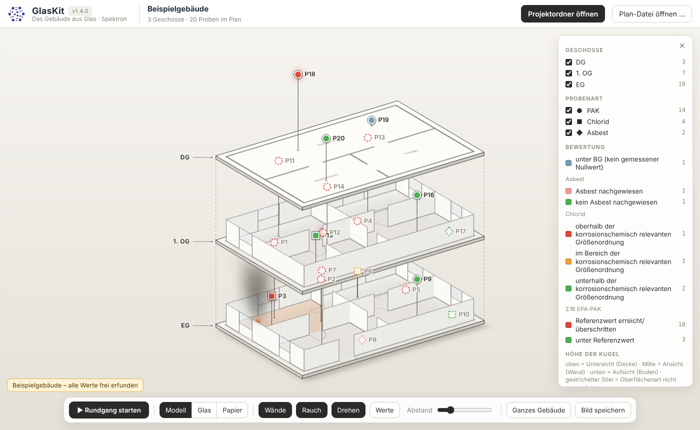

# GlasKit

Das Gebäude aus Glas – Teil der Spektron-Suite.

GlasKit liest eine PlanKit-Datei (`*.probenplan`) **nur lesend** und zeigt die Geschosse als gestapelte Glasplatten. Jede Probe leuchtet an ihrer Stelle: Form nach Probenart (Kreis PAK, Quadrat Chlorid, Raute Asbest), Farbe nach derselben Bewertung wie PlanKits Ergebniskarte, Höhe nach Oberflächenart (Aufsicht unten, Ansicht Mitte, Untersicht oben).

Aktuelle Version: **1.1.0** (steht oben neben dem Namen).

## Benutzen

Aus der **Projektzentrale**: Projekt wählen → „Mehr zum Projekt …“ → **„GlasKit öffnen“**. GlasKit öffnet dann `#projekt=<Ordnername>` direkt. Fragt der Browser nach dem Zugriff, steht ein Knopf „Projekt … öffnen“ da – ein Klick reicht. Gibt es im Projekt noch keinen Plan, sagt GlasKit das und bietet PlanKit an.

Oder `index.html` in Edge oder Chrome öffnen (oder über GitHub Pages) → „Projektordner öffnen“ oder „Plan-Datei öffnen …“. Ohne Projekt: „Beispielgebäude ansehen“ (alle Werte frei erfunden).

- Ziehen = drehen · Umschalt + Ziehen = verschieben · Mausrad = Zoom
- Klick auf eine Probe: Karte mit dem Wert wie im Prüfbericht, Geschosse darüber werden durchsichtig
- „Rundgang“: Kamerafahrt von Probe zu Probe (Leertaste = Pause, Pfeiltasten, Esc)
- „Bild speichern“: PNG der aktuellen Ansicht als Download

## Grundsätze

- Eine Datei, offline, keine Abhängigkeiten, kein WebGL (läuft auch über RDP).
- GlasKit schreibt nie in den Projektordner.
- Werte und Bezeichnungen stehen so da wie im Prüfbericht. Es wird nichts interpoliert. Ohne Bewertungsskala im Projekt bleibt eine Probe grau.
- Der Rauch am Brandherd ist reine Dekoration, keine Berechnung.
- Sind nicht alle Pläne kalibriert, ist die Darstellung nicht maßstäblich; Geschosse werden mittig gestapelt.

## Projektübergabe (`#projekt=`)

Wie PlanKit und FotoKit: Archivordner aus IndexedDB `mosaik-suite`, Store `kv`, Schlüssel `archiv`; dann den Projektordner per Name. GlasKit fragt **nur nach Leserecht** (`{mode:'read'}`). Wo die PlanKit-Datei und `_Projekt.json` liegen (`_Spektron/…` oder früher `Pläne/`), entscheidet `spektron-ordner.js` – eine byte-gleiche Kopie der Vorlage aus der Projektzentrale steht als eigener `<script>`-Block in `index.html` und wird nur ohne `anlegen` benutzt.

## Pflege

Die Bewertungsregeln (VdS-2357-Referenzen, KORROSION-CHLORID v2, Asbest-Befund, Hauptwert je Probenart) sind aus `Probenplan/src/results.ts` übernommen. Ändert sich dort etwas, hier mitändern. Ändert sich `spektron-ordner.js` in der Projektzentrale, den Block in `index.html` ersetzen.

## Prüfen

`tests/glaskit-check.cjs` (Playwright, erfundene Daten, Bildschirmfotos nach `tests/out/`): `node tests/glaskit-check.cjs a|b|c|alle`. Kein Testgerüst, keine CI.
